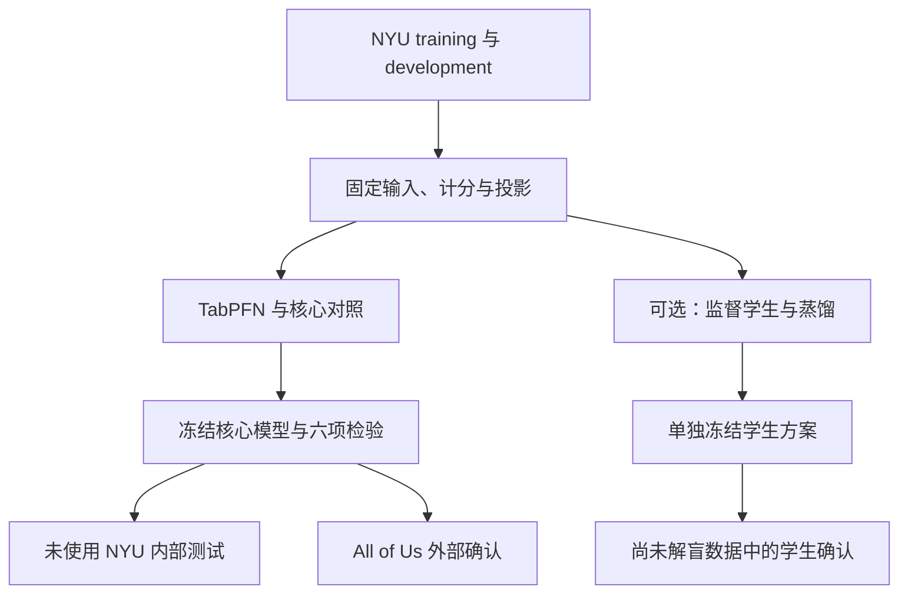

# Ancestry-aware PRS Protocol v2

## 连续祖源信息下的多 PRS 整合与跨队列验证

> **主版本：** Markdown v2.0\
> **协议标识：** `aaprs_v2_prediction_transfer_20261011`\
> **更新日期：** 2026-10-11（America/New_York）\
> **研究疾病：** T2D、CAD、女性乳腺癌\
> **开发来源：** NYU\
> **验证来源：** 未参与开发的 NYU 内部样本、All of Us、其他独立外部队列\
> **状态：** 研究方案已更新；T2D 新增相同 25 个 D-PRISM 来源的整合比较，执行状态与结果单列于[补充分析](T2D_DPRISM25_Comparison_20261011.md)。尚无独立外部确认结果。\
> **版本关系：** 本文件取代《Ancestry Aware PRS Research Proposal CN 20261011》v1 的研究优先级、假设层级、主要比较和执行顺序；作为后续实施与论文写作的主协议。既有结果仍按原始实验版本解释。

---

## 0. 本轮更新的核心决定

**主研究验证：在 NYU 学习的多 PRS 整合函数，是否能在独立队列中，相比遗传距离插值及合理的强对照取得有意义的预测改进。**

稳定、可信且能迁移的预测改进可以独立构成主要贡献。蒸馏、新网络结构、新 GWAS 和生物学机制发现均不是主研究成立的前置条件。

| 项目 | v2 决定 |
|---|---|
| 主贡献 | 多 PRS 整合的预测改进与 NYU 来源训练后的跨队列迁移 |
| 核心文献对照 | DiscoDivas 同输入适配，保留其中心地位 |
| 强方法对照 | 小型预定集合中的 NYU-selected baseline；避免仅与欠拟合的线性模型比较 |
| 主要检验 | 三疾病 × 两类比较，共六项配对 ΔAUC，统一 Holm 校正 |
| 祖源作用 | 主研究报告祖源覆盖和分层表现；“系数随祖源变化的独立价值”单独验证 |
| 蒸馏 | 保留完整方案，作为可并行开展的独立扩展，不阻挡教师外部确认 |
| 实验成功要求 | 不要求六项主比较或所有扩展全部阳性；论文主张与实际证据对应 |
| 优先顺序 | 固定输入与比较 → NYU 核心对照 → 冻结后的外部确认；解释与蒸馏按价值推进 |
| 投稿目标 | AJHG 与 Nature Communications 均保留；不以方法复杂度或蒸馏成功作为硬性门槛 |
| 范围 | 不新增 UK Biobank 分析；主研究不重做 GWAS、不进行新的 TabPFN 预训练 |

### 0.1 必做与条件性扩展

| 层级 | 内容 | 完成标准 |
|---|---|---|
| **核心** | 冻结输入、表型、患者划分、计分与 PC 投影 | 能用固定配置处理 NYU 与外部数据 |
| **核心** | TabPFN、DiscoDivas 适配、固定系数/灵活基础项及强非线性对照 | 输入与信息使用清楚，调参在 NYU 完成 |
| **核心** | 独立内部/外部评价、概率质量、遗传增量、祖源覆盖 | 有逐队列效应量、区间和完整结果 |
| **优先扩展** | MoEPRS 及其他最接近的方法学对照 | 在可用实现上合理运行；未完成时记录原因和比较范围 |
| **条件性扩展** | 固定与祖源可变 PRS 系数比较 | 用于支持更具体的 ancestry-conditioned coefficient 主张 |
| **条件性扩展** | 透明学生、蒸馏、保真度、稳定性与部署成本 | 有增量时强化论文；无增量时可收缩或删除主线地位 |
| **可选** | 小型机制仿真、非负比例学生、分数家族删除分析 | 回答具体剩余问题，避免无目的扩张 |

---

## 1. 研究问题、假设与可支持的结论

### 1.1 核心问题

在已有公开 PRS 权重固定的条件下，利用 NYU 个体标签、多个 PRS 及连续遗传祖源坐标学习的整合器，能否在其他队列保持预测优势？

每个疾病分别训练模型；本文不将三个疾病视为三个完全独立的队列。

### 1.2 假设层级

| 标识 | 问题 | 主要证据 | 地位 |
|---|---|---|---|
| **H1-D** | 学习型整合是否优于遗传距离插值？ | 同一匹配面板下 TabPFN vs DiscoDivas 适配的外部 ΔAUC | 核心 |
| **H1-B** | 完整面板的 TabPFN 是否优于预选强基线？ | 完整面板 TabPFN vs NYU-selected baseline 的外部 ΔAUC | 核心 |
| **H2** | 祖源相关 PRS 系数是否有额外价值？ | 相同基础项下，可变与固定系数的比较 | 条件性支持 |
| **H3** | 蒸馏是否为同结构学生增加能力？ | 蒸馏学生 vs 真实标签学生，并量化相对教师的损失 | 条件性支持 |

H1-D、H1-B、H2、H3 各自回答不同问题。H1-D 成立而 H1-B 不成立时，可以支持学习型整合相对距离插值的收益；不能据此声称 TabPFN 独有最优。H2 或 H3 未获得支持，不自动否定 H1。

### 1.3 主张的边界

- 总体预测优势支持整合器的实用价值。
- 连续 PC 输入与祖源分层结果，支持对祖源信息及适用范围的描述。
- PRS×祖源作用需要 H2 的专门对照，不能仅由“加 PC 胜过不加 PC”推断。
- 学生的可解释系数属于预测模型参数；生物学或因果解释需要额外证据。
- 当前主终点为疾病状态预测及风险分层，不直接解释为未来十年发病概率。

---

## 2. 现有证据与文献定位

### 2.1 当前开发数据规模

以下来自 2026-10-10 项目进展报告，表示当前开发划分，不替代最终纳入清单。[1]

| 疾病 | Training 人数 | Training 病例 | Development 人数 | Development 病例 |
|---|---:|---:|---:|---:|
| T2D | 5,811 | 1,701 | 2,852 | 847 |
| CAD | 5,811 | 2,313 | 2,852 | 1,072 |
| 女性乳腺癌 | 3,308 | 602 | 1,628 | 320 |

### 2.2 已报告的性能

完整面板 TabPFN 直接概率 AUC：T2D `0.764329`、CAD `0.812933`、女性乳腺癌 `0.715345`。[1]

2026-10-10 历史适配配置使用 T2D 五个 D-PRISM metascores、CAD 两个 PRS、乳腺癌三个 PRS。下表保留原版本记录；当前统一参考 PC 与风险链接后的数值见[修正报告](NYU_Internal_Analysis_Results_20261011.md)，不能将下表差值移用于新配置：

| 疾病 | TabPFN | DiscoDivas 适配 | 线性整合 | 相对 DiscoDivas 的绝对 ΔAUC |
|---|---:|---:|---:|---:|
| T2D | 0.765747 | 0.747072 | 0.747498 | +0.018676 |
| CAD | 0.811875 | 0.799862 | 0.800209 | +0.012014 |
| 女性乳腺癌 | 0.716607 | 0.677535 | 0.685464 | +0.039072 |

这些观察构成继续推进的实质依据。报告中六项比较经 Bonferroni 调整后的配对区间高于零；这些区间条件于已保存的开发预测，不涵盖此前自适应模型选择或重训练的不确定性。现有 development 已参与开发，继续如实标记为开发证据。[1]

**完整面板结果和匹配面板结果不能混用。** v2 若改变 Disco 风险链接、基础项或其他预处理，应生成新的实验版本并重新计算；不得沿用上述差异作为新配置的结果。

### 2.3 DiscoDivas 的角色

DiscoDivas 将已有、在不同来源调优的 PRS 按连续祖源空间中的遗传距离组合，面向缺少充分匹配调优样本的场景。其研究价值包含明确的问题与实证支持，算法复杂度并非本协议评价贡献的尺度。[2]

当前项目已核验相应插值计算，但使用替代 PRS、参考中心及来源冻结预处理。原文 CAD/T2D 八套最终模型资产未取得，原文完整部署记录为 `NOT_RUN`；乳腺癌是该框架在本研究中的新增疾病应用。[1]

v2 保留“DiscoDivas 同输入适配”作为核心比较。使用自有 PRS 面板进行框架比较具有价值；关键在于合理匹配输入及参考中心、清楚描述适配，而非等待原文全部资产后才开展研究。

### 2.4 MIXPRS 与其他相关工作

MIXPRS 在 summary statistics 层使用 data fission、LD 处理及非负组合学习分数。当前 CAD 输入 `PGS012558` 为面向 EAS 的 MIXPRS+ 成品。[3] 比较该分数的部署表现和使用 NYU 标签后的增量，不等于在相同 GWAS 构建资源下全面替代 MIXPRS。

当前报告没有完整列出可核验的 MIXPRS head-to-head 数值；保留用户观察为待整理结果，不填入未经报告的 ΔAUC。

相关工作包括 MoEPRS 的个体条件化组合、祖源相关表格基础模型，以及 TabPFN 局部蒸馏。[4–6] 本研究的贡献由问题、预测收益、迁移及适用范围共同支撑；既有组件不妨碍形成有价值的方法研究。

---

## 3. 队列、患者划分和终点

### 3.1 数据角色

| 数据部分 | 用途 | 禁止用于 |
|---|---|---|
| NYU training | 拟合预处理、教师 context、基线训练、学生训练 | 充当独立 test |
| NYU development | 有限模型选择、超参数、主要基线与风险链接选择 | 充当首次独立确认 |
| NYU untouched test | 冻结后内部评价 | 反馈修改待确认模型 |
| All of Us | 拟定核心教师外部确认 | 主分析再训练、再校准或选模型 |
| 其他外部队列 | 预先登记的复现；必要时承担学生独立确认 | 按模型表现决定是否纳入 |

NYU 最终拟合范围可预先选为 training，或在完成选择后合并 training+development；必须在冻结清单中明确。合并后重新拟合所有需要学习的对象，原 development 不再提供独立性能估计。

### 3.2 独立性与表型

1. 按患者划分；近亲按 family/kinship cluster 分组，避免跨训练与测试。
2. 内部 test 使用未参与当前开发的患者，优先采用预定义时间窗内连续合格样本。若没有新内部留出，保留现有开发结果，由外部承担确认；不从已使用样本中重新切出“全新 test”。
3. 核查公开 PRS 的 discovery、tuning 和最终 evaluation 样本用途，以及与 NYU/外部的重叠。某队列仅被上游研究评估过，不自动等于调优泄漏。
4. 可行时核查跨项目重复参与者，并记录无法完全排除的重叠。
5. 主分析固定病例定义、对照要求、索引日期、年龄提取时点、EHR 观察窗与缺失处理；外部使用概念一致的表型映射。
6. T2D/CAD 保留现有合格人群；乳腺癌限定既定女性人群并移除恒定 sex 列。
7. 自报种族/族裔用于队列描述及必要的异质性分析；遗传祖源输入来自预定参考坐标。

在查看候选模型的外部表现前，可以完成表型构建、病例/对照计数、重复核查及结局无关的计分 QC。不能依据模型表现选择病例算法、祖源分组、面板或人群。

### 3.3 外部队列锁定

All of Us 作为主要确认队列，以通过上游重叠与可用性核查为前提。若不能满足，应在模型结果解盲前固定无重叠面板、独立患者集合或其他确认队列，并记录原因。

其他 external 的名称、版本、样本量与祖源覆盖目前待填写，不虚构外部样本数。不能在看到哪个队列表现最好后再指定主要确认队列。

---

## 4. 输入、PRS 面板与统一预处理

### 4.1 模型输入

对疾病 d，输入记为 X=(Z,C,A)：Z 为该疾病的多 PRS，C 为年龄/性别等既定协变量，A 为 PC1–PC10。

| 疾病 | 完整 PRS 数 | 协变量与祖源 | 基础输入列数 |
|---|---:|---|---:|
| T2D | 26 | 年龄、性别、10 PCs | 38 |
| CAD | 3 | 年龄、性别、10 PCs | 15 |
| 女性乳腺癌 | 3 | 年龄、10 PCs | 14 |

列数不含患者 ID、标签、队列字段或额外缺失指示。疾病标签只用于 NYU 学习和独立评价，不作为预测特征。32 个 PRS 是三疾病总数。[1]

### 4.2 完整 PRS bank

| 疾病 | 分数 | PGS ID | 数量 |
|---|---|---|---:|
| T2D | D-PRISM，五目标祖源 × 五来源成分 | PGS005353–PGS005377 | 25 |
| T2D | PRScsx_T2D | PGS002308 | 1 |
| CAD | GPS_Mult | PGS003725 | 1 |
| CAD | multi_anc_hg37CSx | PGS004696 | 1 |
| CAD | CAD_EAS_MIXPRSplus | PGS012558 | 1 |
| 女性乳腺癌 | AFR Overall_Prop_M1 | PGS005378 | 1 |
| 女性乳腺癌 | EUR INTERVENE_MegaPRS | PGS004869 | 1 |
| 女性乳腺癌 | Taiwan PRS-CS | PGS018538 | 1 |

上述名称与 ID 沿用当前项目清单。[1] 所有合格患者均计算相应疾病的全部分数。D-PRISM 成分共享上游信息；MIXPRS+ 与 GPS_Mult 也存在共享信息，列数不代表独立遗传证据来源数。[1,3]

### 4.3 区分原始分数来源与中间特征

| 面板 | 用途 | 当前定义 |
|---|---|---|
| `P_FULL_d` | 完整系统与强基线比较 | T2D 26；CAD 3；BC 3 |
| `P_DISCO_d` | DiscoDivas 相同中间特征比较 | T2D 25 个来源成分组合成 5 个 metascores；CAD 2 个既有分数；BC 3 个分数 |
| `P_DPRISM25_T2D` | 相同原始分数来源、不同整合流程 | 两方都使用 PGS005353–PGS005377；TabPFN 直接整合 25 成分，Disco 经公开 25→5 组合后插值 |

每个 ID 同时锁定列顺序、转换、计分版本和中心映射。CAD 两列的具体 ID、T2D metascore 的生成式，必须从已有实验 manifest 读取并写入；不得依据上表推测或重新发明。

H1-D 使用在 `P_DISCO_d` 上拟合的 `T_DISCO_d`，H1-B 使用在 `P_FULL_d` 上拟合的 `T_FULL_d`。若面板及转换完全相同，可复用相同模型对象。

T2D 的五个 metascores 已使用全部 25 个 D-PRISM 成分，不应写成“只用了五个原始 PRS”或“丢弃二十个成分”。公开组内组合固定，组间权重随患者 PC 改变；二阶段流程可展开为对 25 个成分的加权。特征压缩限制组合自由度，不能声称保留全部 25 维信息。

`P_DPRISM25_T2D` 是合理的相同来源比较，不需要为 25 个成分复制祖源中心或新增祖源模型。对应的直接 25 成分 TabPFN、五 metascores TabPFN 与 Disco 统一原定患者、年龄/性别、refPC 及训练内线性祖源校正；具体预处理、共享五折和 development 比较见[补充分析](T2D_DPRISM25_Comparison_20261011.md)。该补充单独记录，不回写已完成的六项核心检验。

完整 T2D 教师另含 PGS002308，其 26 分数结果不能冒充相同 25 来源比较；CAD 完整与匹配面板也存在来源差异。完整系统的部署比较可另行报告，并明确这些差异。

### 4.4 计分规则

- 沿用当前 GRCh38、PGS 匹配与 PLINK2 计分流程；冻结等位基因方向、剂量及求和/平均规则、重复变异与缺失基因型处理。
- 当前 75% SNP 匹配覆盖门槛作为已有规则保留，记录实际匹配数、缺失模式及可计算的加权覆盖；该门槛不等于完整重现原发表分数。[1]
- 固定参考频率，不利用外部结局调整缺失处理。
- 外部缺少整个 PRS 时，采用预先训练并冻结的共同可用面板模型；不临时填入目标均值并声称评价原完整模型。
- 如进行共同 SNP 掩膜敏感性分析，先在 NYU 重新计分和训练并冻结，记录为独立模型版本。

### 4.5 统一坐标与缩放

$$
Z_{ij}^{(d)}=\frac{R_{ij}^{(d)}-\mu_{j,\mathrm{NYU\ fit}}^{(d)}}{\sigma_{j,\mathrm{NYU\ fit}}^{(d)}}.
$$

`NYU fit` 为当前模型的确切拟合患者集合；交叉拟合时为相应训练折。乳腺癌参数来自合格女性。

各队列使用同一冻结 PC 参考、载荷、标记集合及投影规则。不得直接混用各队列自行 PCA 得到的同名 PC。Disco 插值参考中心与其坐标系统、输入来源逐一对应；若与教师的主坐标不同，明确分别记录。

H1-D 中，`T_DISCO_d` 与 `D_ANCHOR_d` 的 PC 输入必须来自相同的参考、投影和变量定义。Disco 距离计算可保留预定尺度，教师可使用 NYU 固定数值缩放，但两者须基于相同底层信息。`T_FULL_d` 可以保留另一套明确冻结的主坐标。若匹配比较实际使用不同来源的 PC，仅记录差异不足以称为严格同输入。

主完整面板保留连续 PC，不增加 soft ancestry。PRS 的 PC 残差化作为预定敏感性；拟合仅使用 NYU。Disco 匹配面板按其预定协调流程处理，各参与该面板比较的方法得到一致的转换后分数。

年龄/性别等缺失处理沿用可核查的既定实现。若缺少既定规则，在 NYU 开发内补齐并锁定；新增缺失指示列时更新列数与面板 ID。外部不得重新学习填补参数。

---

## 5. 主预测器与核心对照

### 5.1 TabPFN 主预测器

保持当前 `TabPFN-3 default checkpoint, 16 estimators` 配置，除非在外部解盲前根据预定 NYU 开发流程做出有记录的变更。[1]

$$
q_i=T_{\mathcal D_{\mathrm{NYU\ fit}}}(Z_i,C_i,A_i).
$$

预训练参数冻结；NYU 的标记样本构成 in-context 训练信息。本文不能把“预训练参数不更新”表述成“不使用 NYU 标签”。

主输出采用直接概率。既有 OOF logistic wrapper 为单独预定敏感性模型，不能按外部疾病/指标事后选择直接概率或 wrapper 中较好者。任何来源校准均仅在 NYU 完成。

冻结对象包括 checkpoint、软件环境、种子、context 患者清单、预处理、列顺序、查询批处理方式和输出定义。做一次与具体实现相关的排列/批次一致性核验；若实现依赖查询集合，应报告推理假设。

### 5.2 核心比较清单

| 模型 | 输入/配置 | 作用 | 优先级 |
|---|---|---|---|
| 协变量模型 | C+A | 量化非 PRS 输入的预测能力 | 核心 |
| 正则化多 PRS LR | 同面板 PRS+C+A | 固定系数基线 | 核心 |
| 灵活基础项 + 固定 PRS 系数 | 年龄/PC 加性平滑项及固定 PRS 斜率 | 控制协变量主效应欠拟合 | 核心 |
| CatBoost | 同面板 PRS+C+A | 强常规非线性对照 | 核心 |
| DiscoDivas 适配 | `P_DISCO_d`，固定参考与风险链接 | 连续祖源距离插值锚点 | 核心 |
| TabPFN | `P_FULL_d`、`P_DISCO_d`，以及 T2D 的 `P_DPRISM25_T2D` | 主要学习型整合器；分别记录完整面板、相同中间特征和相同来源比较 | 核心 |
| MoEPRS | 可用的同面板个体条件化实现 | 最接近的方法学对照 | 优先补充 |
| 监督/蒸馏学生 | 同完整面板，见第 10 节 | 结构及知识转移价值 | 条件性扩展 |

MoEPRS 使用个体属性学习预训练 PRS 的组合。[4] 按其二分类实现合理运行，区分疾病预测与 gating 权重的接口。它应优先进入完整研究；若实现暂未完成，第一轮核心外部评价可先执行，并如实登记 `NOT_RUN`。不将未运行方法表述为已被超越。

### 5.3 有限调参与 B* 的选择

在外部结果解盲前，为各方法登记 NYU 调参范围、预算、种子与选择指标。核心对照需要合理调参；不要求不同算法具有完全相同运行时间，也不允许仅为新方法大量搜索。

每个疾病的 `B*_FULL_d` 从预定集合中，按 NYU development AUC 选择；完全平局时依次以 log loss 与预定简单性顺序决定。默认集合为：正则化 LR、灵活基础项+固定 PRS、CatBoost；MoEPRS 若在该轮冻结前完成，则按预先声明的纳入规则加入。

主比较集合及候选纳入状态必须在外部解盲前锁定。外部不重新挑选 B*；全部预定方法的结果仍报告。后补方法可以增加支持性比较，不回写已完成的主要检验。

### 5.4 DiscoDivas 适配必须记录什么

1. 每个输入 PRS 或 metascore 的实际来源。
2. 来源与祖源中心的一一映射及参考坐标。
3. PRS 残差化、标准化、距离与质量权重规则。
4. 原实现默认值与本研究适配差异。
5. 将组合分数转换为疾病概率的 NYU 风险链接。

T2D 按 D-PRISM 公开系数先组合 25 个成分，再将五个 metascores 对应到五个参考中心，即可整合全部 25 个成分。不能为凑齐输入列数随意复制或分配中心；PGS002308 若加入，须单独规定最终整合方式。当前原论文八套资产缺失不阻塞合理的框架比较。

为避免协变量处理削弱对照，Disco 的组合分数配合相同可用 C+A，在 NYU 拟合风险链接。预先比较既有链接与灵活基础项链接，按 NYU 指标选择一个作为 `D_ANCHOR_d`；另一版本完整记录。灵活基础项读取 C+A，组合分数保持单一预测项，不新增任意 PRS 输入。

该选择、输入与变换在外部冻结前完成。`T_DISCO_d` 使用相同匹配分数及 C+A。新风险链接产生的新比较不得继承历史 AUC 数值。

### 5.5 已发表成品分数的部署比较

各单分数配合相同可用协变量，在 NYU 拟合风险链接后冻结。最佳单分数仅在 NYU 选择。

CAD 优先展示 MIXPRS+、GPS_Mult、单 MIXPRS+ 的灵活模型及完整多分数模型，区分成品分数、模型灵活度和增加 PRS 信息的作用。该分支不是重新实现全部上游 GWAS 方法。

---

## 6. 主要外部检验与统计计划

### 6.1 两类核心效应量

对疾病 d，在同一目标评价人群分别计算：

$$
\Delta^{(d)}_D=\mathrm{AUC}(T_{\mathrm{DISCO},d})-\mathrm{AUC}(D_{\mathrm{ANCHOR},d}),
$$

$$
\Delta^{(d)}_B=\mathrm{AUC}(T_{\mathrm{FULL},d})-\mathrm{AUC}(B^*_{\mathrm{FULL},d}).
$$

两类比较的输入面板不同，各比较内部保持一致。每条结果必须记录 `panel_id`、`teacher_variant` 与 `comparator_id`。

### 6.2 主要检验族

默认主要确认队列为通过核查的 All of Us。T2D/CAD/BC × D/B 构成 **六项主要比较**，统一进行双侧 Holm 校正，family-wise α=0.05。

- 同时报告 ΔAUC、普通 95% 配对区间、原始 P 值及 Holm 调整 P 值。
- 普通 95% 区间为逐比较区间，不声称六项同时覆盖。
- 如需同时区间，可预先采用六项 Bonferroni 99.1667% 区间；不默认增加此输出。
- 不要求六项全部阳性。每项结论依据效应量、区间和预定检验解释。
- 若预定疾病/比较确实无法计算，保留原六项家族位置、解释原因；校正计算中将该未检验项视作 P=1，不根据结果缩小家族。
- 本家族只覆盖核心比较。不能把它描述为控制全篇所有探索与扩展检验。

NYU 未使用内部 test 与其他 external 按冻结方法报告，默认作为预先登记的复现。若改为多队列共同确认，必须在任何相关结果解盲前重订检验族。外部已看过的结果不能被事后提升为新确认。

### 6.3 配对不确定性与检验

- 配对 bootstrap 初始 5,000 次，所有方法共享重采样索引。
- 独立患者以患者为单位；存在相关患者时以预定 family/kinship cluster 为单位。
- 独立患者的配对 AUC P 值采用 DeLong。[7]
- 存在聚类时采用预定的 cluster bootstrap 检验；不直接套用独立患者 DeLong。
- 聚类 ΔAUC 或平均 log loss 差使用零假设中心化重采样：令观察效应为 θ̂，第 b 次为 θ̂*b，以 `|θ̂*b−θ̂| ≥ |θ̂|` 的尾部比例形成双侧近似 P 值，采用 `(1+尾部计数)/(B+1)`。聚类下重采样整个 cluster，指标仍按预定患者权重计算。
- 普通区间默认配对 percentile bootstrap；方法及随机种子在解盲前固定。检验 P 值不由区间是否跨零机械替代。
- 若尾部 Monte Carlo 误差足以改变临界判断，按预定规则增加至 20,000 次并记录；不为追求显著性反复重采样。
- 无病例/无对照导致 AUC 不可计算的 bootstrap 比例需记录。若不稳定，应标记估计不足或采用预先规定的合适策略，不能静默删除并强行给出精确结论。

固定预测的 bootstrap 描述该冻结模型在目标队列的抽样不确定性。NYU 重训练实验刻画训练不稳定性，两者分开报告。

### 6.4 核心指标

| 维度 | 指标 | 用途 |
|---|---|---|
| 区分度 | AUC、配对 ΔAUC | 核心性能 |
| 概率质量 | Log loss、Brier score | 对真实结局的误差 |
| 校准 | 校准截距、斜率、曲线 | 外部冻结概率的偏差 |
| 遗传增量 | 相对匹配协变量模型的指标差 | 多 PRS 增加的信息 |
| 风险分层 | 预定来源阈值下捕获率、PPV、OR | 高风险人群识别 |
| 祖源覆盖 | 各组/连续坐标的样本数、病例数与效应 | 适用范围 |

每种主要学习器的协变量模型使用匹配的训练和选择流程单独拟合。完整模型中把 PRS 设置为零，不等于一个独立训练的协变量基线。

遗传增量为预测指标差，不等于遗传力或因果效应。AUC、校准与损失应联合解释，不能因一种指标有利而隐藏另一种。

效应方向统一记录：ΔAUC 为“新模型减对照”，log loss/Brier 改善为“对照损失减新模型损失”，均以正值表示改善。原始指标同时保存。计算 log loss、KL 或 logit 诊断时，对所有方法使用预先固定的同一数值截断规则，默认 ε=10⁻⁷；保留原始概率用于 AUC 和输出，不以截断或再校准改变原始排序。

### 6.5 校准与风险阈值

外部可以用结局拟合校准诊断模型，计算截距与斜率；主结果不将参数回写到外部预测。外部再校准如后续开展，另列适应性分析。

固定部署阈值来自 NYU；同时报告它在外部实际选择的比例。目标队列内最高 10% 属于目标相对分位分析，应与固定来源阈值分开。OR 的比较组和协变量调整预先定义。没有明确临床行动时，不把 NRI 或 decision curve 列为核心任务。

---

## 7. 祖源覆盖、异质性与样本量

### 7.1 主研究必须报告的祖源结果

- 预定遗传祖源描述组的总人数、病例与对照数。
- 各组预测效应与不确定性，辅以连续 PC 支持范围。
- NYU 来源样本覆盖较少区域的表现；符合纳入标准的人群不能在看到结果后删除。
- 连续坐标与离散组使用的参考及分类规则。

`AMBIGUOUS` 不自动等于 admixed。只有合适的祖源识别和定义才支持混合祖源主张。现有 BC SAS-like 开发组 42 人、8 病例，不能据此提出稳定的该组优效结论。[1]

小组区间较宽不自动否定总体结果；也不能由总体胜出声称所有祖源均获益。探索性分组/局部曲线不变成新的未校正确认检验。

### 7.2 连续分析

采用 NYU 训练分布定义的距离或密度支持指标；局部窗口、平滑自由度及展示规则在外部解盲前固定。显示有效样本与病例数。逐点区间不称为整条曲线的同时置信带。

年龄、祖源构成、平台和 EHR 观察窗差异可以影响跨队列结果。在病例与非病例的预测分布各自固定时，单纯改变病例比例不改变 AUC；患病率变化仍影响校准、Brier 与 log loss。队列差异不能一概解释为遗传效应改变。

### 7.3 样本量与实用效应

先整理逐疾病病例/对照数及祖源覆盖，再使用 NYU 开发预测的配对相关性估计外部 ΔAUC 的区间精度和检出能力。[8]

可使用绝对 ΔAUC `0.005 / 0.010 / 0.015` 作为保守设计情景。这些是情景假设，不是外部预期结果或期刊门槛。最小值得争取的收益应结合效应大小、解释范围和实施成本，在外部解盲前记录。

若估计区间很宽，结论为信息不足；若有足够精度排除值得争取的增益，才支持收缩投入。不得用事后功效或单一 P>0.05 判断项目无价值。

---

## 8. 执行顺序与两次冻结

### 8.1 核心执行路线



| 阶段 | 优先工作 | 核验产物 |
|---|---|---|
| 1 | 队列/表型与上游核查、两类面板、PC 对齐 | 数据字典与面板清单 |
| 2 | NYU 核心模型、合理基线、D anchor 与 B* 选择 | 完整开发比较表与配置 |
| 3 | 核心冻结并执行内部/第一外部确认 | 六项主效应及校准/遗传增量 |
| 4 | 依据预定计划完成其他队列复现 | 逐队列效应与适用范围 |
| 并行扩展 | 祖源系数学生、蒸馏、必要的稳定性 | 独立标记的扩展证据 |
| 5 | 按实际贡献组织论文与公开资源 | 正文、补充、可运行模型包 |

核心外部计分和表型准备现在即可开展。学生、权重图与仿真不作为阶段 3 的前置条件。

### 8.2 核心冻结记录

在首次查看任何用于核心确认的 NYU 内部或外部测试性能前，锁定：患者集合、主要队列、病例定义、完整/匹配面板、教师及基线、风险链接、预处理、主要检验、子组与敏感性规则。

保存 `core_freeze_id`、配置/代码哈希与冻结日期。外部结果不反馈调参、挑面板、选择教师或改变主要比较。

### 8.3 教师先完成时，如何保护学生的独立确认

**来源拟合仅在 NYU 完成，并不足以自动保证学生的外部独立性；模型结构和选择规则也可能受到已经看到的外部结果影响。** 评价数据应与开发/调参/选择分开，这与预测模型评价原则一致。[11,12]

默认采用以下 A 路径；B/C 可在条件满足时使用：

| 路径 | 学生状态 | All of Us 对学生的角色 | 学生确认安排 |
|---|---|---|---|
| **A：核心先行** | 教师外部解盲前学生方案尚未锁定 | 后续学生结果为探索/支持 | 预先保留的另一外部队列或从未解盲的独立患者/家系集合 |
| **B：同时冻结** | 学生配置和参数在同次解盲前均已冻结 | 可用于预定学生评价 | 学生仍使用独立的次要检验族 |
| **C：算法先锁定** | 学生代码、候选网格、NYU-only 选择和拟合规则已完整锁定，计算稍后完成 | 在无任何外部反馈修改的可审计条件下，可按预定评价执行 | 记录算法锁定时间、最终参数时间与全部差异 |

路径 C 不是允许外部结果驱动新结构的例外。若开发者据外部表现修改候选、参数规则或选模型，即转为 A；同一集合不能继续称为该学生的独立确认。

学生后续开发不会追溯取消已经冻结完成的教师确认结果。评价角色按模型版本及其开发历史分别记录。

相同原则适用于已解盲的 NYU untouched test。任何确认集合的已见结果若参与学生结构或选择规则调整，该集合对相应学生版本转为开发支持证据。

患者/家系保留集必须在解盲前划分且没有进入已查看的总体模型性能结果。已经用完整 All of Us 结果选方案之后，再从中切一个子集不能恢复独立性。

新的敏感性或模型改进可以研究，但需要新的冻结标识和恰当的支持性/探索性标签；不覆盖首次核心结果。

---

## 9. 条件性扩展一：祖源系数的独立价值

### 9.1 结构比较

固定系数模型：

$$
\ell_i=b_\phi(C_i,A_i)+\sum_j\bar\beta_j Z_{ij}.
$$

可变系数模型：

$$
\ell_i=b_\phi(C_i,A_i)+\sum_j\beta_j(A_i)Z_{ij}.
$$

两者采用同一基础项函数类、面板、变换、训练数据和合理选择预算。H2 的主要结构比较使用真实标签监督（λ=0），避免把结构和蒸馏同时改变。

基础项应充分表达年龄和 PC 主效应，避免由主效应欠拟合产生虚假的交互收益。若增加 KD 下的结构敏感性，固定两者 λ 及 OOF 目标。

### 9.2 结果解释

- 可变系数更好：支持连续祖源条件系数的额外预测价值。
- 固定与可变相近：保留主预测贡献，弱化“系数必须随祖源变化”的主张。
- 无显式 PC 的模型也可能通过 PRS 编码祖源，不能把其结果当作完全不含祖源信息。
- 祖源差异不被直接解释为特定生物学原因。

连续 PC/离散祖源/无显式 PC、T2D 26 分数 vs 五 metascores+PGS002308 的六分数面板等，均为有针对性的辅助比较，预先保持其他处理一致。

---

## 10. 条件性扩展二：透明学生与蒸馏

### 10.1 学生定义

$$
\operatorname{logit}(p_{S,i})=\ell_i=b_\phi(C_i,A_i)+\sum_{j=1}^{M_d}\beta_j(A_i)Z_{ij},
$$

$$
\beta_j(A)=\bar\beta_j+\gamma_j^\top B(A),\qquad
\frac{1}{n}\sum_{i\in\mathrm{NYU\ fit}}B(A_i)=0.
$$

基础项仅读取 C+A，系数函数仅读取 A。首版 B(A) 为训练中心化/缩放后的 PC，正则化向固定系数收缩；可选低自由度平滑基函数在 NYU 预定范围选择。

基础项采用带收缩的加性模型，年龄使用训练内固定结点的自然样条，sex 按既定编码进入，PC 主效应灵活度至少与 gate 相匹配。完整模型联合拟合基础项和 PRS 项。

主版允许正负系数。线性 PC 参数化展开后为 PRS×PC 交互模型；其数学结构不作为独占创新主张。

### 10.2 参数与个人贡献

$$
\left.\frac{\partial\ell_i}{\partial Z_{ij}}\right|_{A_i,C_i,Z_{i,-j}}=\beta_j(A_i),\qquad
\phi_{ij}=\beta_j(A_i)Z_{ij}.
$$

β 是条件 log-odds 斜率，φ 是相对固定参考的 logit 加法贡献。患者输出同时提供 Z、β、φ，不把系数与贡献混称为权重。

参考默认是 NYU fit 全局均值，即 Z=0。它是模型分解参考，不一定是真实患者或该祖源平均患者。负贡献表示相对参考降低 logit，不能自动解释为生物学保护。概率经 sigmoid 变换，不逐项相加。

### 10.3 可选的非负比例模型

$$
\beta_j(A)=\kappa(A)w_j(A),\quad\kappa(A)\geq0,\quad
w_j(A)=\frac{\exp\{u_j(A)\}}{\sum_k\exp\{u_k(A)\}}.
$$

w 为相对组合比例，κ 为总遗传预测尺度。保留 κ 避免人为固定总斜率。该版本不预设优于 signed 版，也不把 w 解释为祖源比例、遗传力份额或疾病风险百分比。

若研究相对组合的作用，比较全局固定、仅 κ(A) 变化、κ(A) 与 w(A) 均变化。仅总体尺度变化有效时，相应收缩相对组合的主张。

### 10.4 OOF 软标签

1. 先固定学生训练与 NYU development 划分。
2. 在学生训练范围内进行默认三折患者/家系分组 OOF 教师预测。
3. 被预测者及其亲属分组的标签从对应教师 context 排除。
4. 每折拟合型预处理仅使用该教师 context；公共固定参考投影可以复用。
5. 记录 OOF 目标对应的折、context 与转换版本。
6. 学生验证标签不能进入任何生成其训练软标签的上游教师。禁止先在全部 NYU 生成 OOF 后再任意切学生训练/验证。
7. 在 NYU development 选定规则后，在最终声明的 NYU 拟合范围重新生成 OOF 目标并训练最终学生。
8. 内部/外部测试患者不用于学生拟合，即使仅查询教师软标签。

### 10.5 损失与有限选择

$$
\mathcal L=\frac{1}{n}\sum_i[(1-\lambda)\operatorname{BCE}(y_i,p_{S,i})+
\lambda\operatorname{BCE}(q_i^{\mathrm{OOF}},p_{S,i})]+\Omega(\phi,\bar\beta,\Gamma).
$$

首轮 KD 候选 λ∈{0.5,1}，temperature=1；必须保留 λ=0 的同结构真实标签学生。可从平均 BCE 尺度下的 L2 强度 {0.001,0.01,0.1,1} 开始，固定特征单位，最终只按 NYU 选择。

学生选择以开发 log loss 为主，并记录 AUC 与保真度。同结构 KD vs hard-only 保持相同基函数与输入；不以更复杂的 KD 学生对比更弱的真实标签学生。

固定基函数与 L2 惩罚下，线性交互学生可用确定性优化器求解；不需要先引入大型神经网络搜索。

OOF context 小于最终教师 context，可能使软目标不同。在 NYU development 诊断这种差异；必要时仅在该开发阶段考虑重复交叉拟合。冻结后的 test 不反馈选择。

### 10.6 学生评价与次要检验

- 分别对真实结局评价教师、监督学生和蒸馏学生。
- 报告学生相对教师的 ΔAUC、log loss、Brier 差异，以及相对核心基线保留的收益。
- 报告概率 MAE、Bernoulli KL、排序一致性，并检查祖源范围与高风险区间。
- 总体一致性可能来自年龄/性别，需同时查看遗传增量。
- H2（可变 vs 固定，λ=0）和 H3（KD vs 同结构 hard-only）的默认支持指标为配对 log loss 改善；若两项扩展均预定开展，三疾病×两比较组成六项次要家族，单独 Holm，并明确区别于主家族。
- 未开展的预定项保留记录，不根据已见结果缩小家族。仅选择一个扩展时，须在相应结果解盲前固定其三项家族。

学生与教师 P>0.05 不证明非劣效。正式非劣效为可选分析，需提前论证疾病特异可接受损失、精度与单侧检验规则；绝对 AUC 0.005 仅可作为讨论起点，不设为公认门槛。

### 10.7 解释稳定性与成本

相关分数可能具有等价系数：

$$
Z_1=Z_2=Z\Longrightarrow a(A)Z_1+[1-a(A)]Z_2=Z.
$$

预测准确不保证每列权重唯一。若将权重解释作为正文贡献，应评估 NYU 重拟合后的系数曲线、方向、幅度及分数组合贡献。

起始方案：固定教师软标签下 50 次患者/家系重采样学生拟合；再用至少 3 个预定分组划分或 context 重建检查流程敏感性。它们是条件稳定性与流程敏感性，不能混成完整精确的患者风险区间。次数可根据成本在查看稳定性结果前预先修订。

T2D 优先同时报告 D-PRISM 家族总贡献。单列不稳定而组贡献稳定时，主解释转向分数组。

学生部署只需冻结学生参数及计分/预处理对象，不需要教师 context。实际速度、内存、模型大小需同硬件、同患者批量测量；分别记录加载、单患者/批量推理和 PRS 计分成本，不预写加速倍数。

---

## 11. 可选小型机制仿真

仅在解释具体剩余问题时运行。使用 score-level 数据：一个连续祖源轴、三个相关 PRS、一个协变量，允许祖源密度不均与 PRS 均值变化。

| 场景 | 设置 | 问题 |
|---|---|---|
| 主效应变化 | 祖源影响基础项，PRS 系数恒定 | 是否错误推断祖源改变 PRS 斜率？ |
| 斜率变化 | PRS 系数随祖源平滑变化 | 可变模型能否获得收益并恢复可识别参数？ |
| 冗余分数 | 两个 PRS 近乎重复 | 单列系数与组合贡献的稳定性有何区别？ |
| 学生失配 | 加入少量 PRS×PRS 项 | 透明学生在哪些情况下丢失教师能力？ |

参数预先固定，起始每场景 20 次重复并报告 Monte Carlo 误差，精度确有不足时再增加。预测误差与系数恢复分别评价，恢复系数前转换到同一标准化单位。仿真不证明真实人群中的生物学机制。

---

## 12. 输出规范与交付接口

### 12.1 核心患者预测表

每行对应患者×疾病×模型版本，至少含：

| 字段 | 含义 |
|---|---|
| `participant_id` | 研究用去标识患者 ID |
| `trait`, `cohort_id`, `split_role` | 疾病、队列及数据角色 |
| `eligibility`, `qc_status` | 纳入与质量状态 |
| `model_id`, `panel_id`, `freeze_id` | 模型、输入和冻结版本 |
| `prediction` | 疾病状态概率 |
| `scoring_version`, `pca_version`, `transform_version` | 计分、祖源投影及转换 |
| `ancestry_group`, `source_support` | 预定描述组与来源支持指标 |

病例标签与预测按受控的评价流程连接。公开示例不包含原始个体记录。

### 12.2 学生解释表，仅在扩展开展时生成

| 字段 | 含义 |
|---|---|
| `student_logit`, `student_probability` | 学生完整预测 |
| `baseline_logit`, `reference_id` | 基础项与参考定义 |
| `prs_id`, `raw_prs`, `standardized_prs` | 每项输入分数 |
| `beta`, `contribution` | β(A) 与 β(A)Z |
| `group_contribution` | 预定相关分数组贡献 |
| `kappa`, `mixture_weight` | 非负版本的可选尺度与比例 |
| `teacher_probability`, `teacher_student_difference` | 研究诊断可选字段 |

验证导出字段可重建：

$$
\ell_i=b(C_i,A_i)+\sum_j\phi_{ij},\qquad p_{S,i}=\sigma(\ell_i).
$$

学生独立部署时不要求 teacher probability。系数可解释学生预测；只有充分保真证据才进一步声称近似教师的个体预测。

### 12.3 队列及研究输出

核心必须交付：队列流程/病例表、全部预定模型性能、六项主要比较、校准、遗传增量、祖源结果、失败/未运行项目、输入与模型版本。

按实际主张追加输出：H2 对应固定/可变系数比较；H3 对应 KD/同结构真实标签比较、教师性能保留及保真度；解释性贡献对应稳定性与患者级分解；部署便利贡献对应实测成本。所有实际开展的扩展均完整报告结果和相应模型版本，不将某一扩展隐性绑定到全部学生任务。

---

## 13. 给实施者的任务与最小验收

以下是建议的职责与产物命名，不代表当前仓库已经存在这些文件或命令。实际仓库路径在实施时映射。

### 13.1 顺序任务

- [ ] 读取既有实验配置，建立 `cohort_manifest`、`phenotype_spec`、`score_manifest` 和两类 `panel_manifest`。
- [ ] 核查 PGS 上游用途、患者/家系划分、外部共同计分能力及 PC 投影。
- [ ] 固定缺失处理、Disco 中心映射、风险链接候选和基线调参预算。
- [ ] 运行 NYU 核心对照，选定 `D_ANCHOR_d` 与 `B*_FULL_d`，保存全部候选结果。
- [ ] 写入 `core_freeze_manifest` 和 `analysis_plan`，记录六项主比较。
- [ ] 一次应用冻结模型到内部 test 与核心 external，保存预测后统一评价。
- [ ] 按预定计划复现其他队列，不依赖外部结果更换主模型。
- [ ] 如开展学生，先登记 A/B/C 路径与可用确认集合，再生成 OOF、拟合、冻结和评价。

### 13.2 有实质作用的检查

| 检查 | 要解决的风险 |
|---|---|
| 患者/家系隔离及 OOF context 排除 | 标签或近亲信息泄漏 |
| 列顺序、分数版本、PC 参考与缩放一致 | 外部输入含义改变 |
| 小规模计分/等位基因核验及参考缺失规则 | PRS 实现错误 |
| Disco 数值计算与中心映射 | 适配不合理削弱对照 |
| 两类主比较对应正确 panel/model ID | 把输入差异当算法优势 |
| 外部预测前后模型/参数哈希一致 | 意外外部再拟合 |
| 配对患者集合与重采样索引一致 | 非配对比较或选择样本 |
| 概率范围、有限值与学生分解恒等式 | 输出接口错误 |
| 冻结与解盲时间、变更记录 | 事后方案被误标为独立确认 |

不需要为低风险文档变动编写测试；实际代码检查围绕上表的具体风险。检查充分后推进，不无限扩张测试范围。

### 13.3 建议配置骨架

以下 YAML 为配置规范示例，不是声称已有可执行配置。`null` 项需要由实际数据/仓库填写；核心冻结前必须解决影响对应比较的项目。

```yaml
protocol:
  id: aaprs_v2_prediction_transfer_20261011
  version: '2.0'
  primary_contribution: predictive_improvement_and_transfer
  traits: [T2D, CAD, BC_female]
  new_ukb_analysis: false

data:
  fitting_source: NYU
  final_fit_scope: null  # training 或 training_plus_development
  internal_untouched_test_manifest: null
  primary_external: All_of_Us
  external_version: null
  external_replication_manifests: []
  upstream_overlap_audit: null
  phenotype_spec: null
  family_cluster_column: null

inputs:
  score_manifest: null
  panel_full_manifest: null
  panel_disco_manifest: null
  panel_dprism25_t2d_manifest: outputs/external_pgs/dprism25_comparison_20261011/prepared/manifest.json
  expected_full_prs_counts: {T2D: 26, CAD: 3, BC_female: 3}
  expected_base_columns: {T2D: 38, CAD: 15, BC_female: 14}
  pca_reference_manifest: null
  missing_covariate_policy: null
  snp_matching_threshold_existing: 0.75
  external_fit_preprocessing: false

teacher:
  family: TabPFN-3
  checkpoint: default
  checkpoint_hash: null
  n_estimators: 16
  primary_output: direct_probability
  context_manifest: null
  wrapper_role: prespecified_sensitivity

comparisons:
  disco_anchor_manifest: null
  baseline_candidates_default: [regularized_lr, flexible_base_fixed_prs, catboost]
  moeprs_freeze_status: null
  baseline_selection: NYU_development_AUC_then_logloss_then_simplicity
  primary_pairs_per_trait: [T_DISCO_vs_D_ANCHOR, T_FULL_vs_B_STAR_FULL]

statistics:
  primary_family_size: 6
  primary_adjustment: holm
  alpha_two_sided: 0.05
  ordinary_ci_level: 0.95
  paired_bootstrap_replicates: 5000
  bootstrap_if_mc_uncertainty_changes_decision: 20000
  independent_auc_test: paired_delong
  clustered_test: null_centered_cluster_bootstrap
  external_recalibration_primary: false
  probability_clip_epsilon_for_log_metrics: 1.0e-7

student:
  role: optional_extension
  blocks_core_external_validation: false
  external_validation_path: A_core_first
  independent_confirmation_manifest: null
  formula: flexible_base_plus_ancestry_varying_prs_coefficients
  first_basis: centered_scaled_PCs
  signed_coefficients: true
  oof_folds_default: 3
  distillation_lambdas: [0.5, 1.0]
  hard_label_control_lambda: 0.0
  temperature: 1.0
  l2_starting_grid: [0.001, 0.01, 0.1, 1.0]
  formal_noninferiority_enabled: false

freezes:
  core_freeze_id: null
  core_first_external_unblinding: null
  student_algorithm_lock_id: null
  student_parameter_freeze_id: null
  student_first_external_unblinding: null
```

---

## 14. 结果驱动的继续、收缩与论文主张

| 结果 | 对应判断与行动 |
|---|---|
| 冻结后仍明显优于 Disco 及强对照 | 加强跨队列复现，主张学习型整合的预测价值 |
| 优于 Disco，与其他强学习器相近 | 强调监督整合的价值，不主张 TabPFN 独有最优 |
| 总收益主要来自协变量处理 | 如实界定预测贡献，弱化特定遗传整合机制 |
| 某疾病稳定、其他疾病弱或不确定 | 可聚焦有证据疾病，完整报告全部预定结果 |
| 祖源可变系数无独立收益 | 保留核心预测论文，收缩系数机制主张 |
| KD 不优于 hard-only | 使用监督学生或移除蒸馏主线 |
| 学生保留能力且解释/部署有效 | 将学生作为有证据的附加贡献 |
| 学生排序好但个体保真不足 | 可报告透明预测器，不声称忠实个体解释教师 |
| 单列系数不稳、分数组稳定 | 以可重复的组贡献解释 |
| 足够精度下排除值得争取的外部收益 | 收缩按当前目标继续投入；保留可复现结果 |

不以单个显著或不显著结果决定项目成败，也不因完整 proposal 已经写好而不断增加模块。后续投入由可靠效应、适用范围和剩余问题决定。

---

## 15. Paper 定位与主图

### 15.1 默认标题与叙事

默认工作标题：

**Learning to integrate established polygenic scores across the ancestry continuum**

若外部结果支持，可使用：

**Ancestry-aware integration of established polygenic scores improves prediction across clinical cohorts**

蒸馏只有在形成实质结果时才进入标题；无需提前把整篇文章绑定到 distillation。

默认正文顺序：研究设计与面板 → NYU 开发比较 → 冻结外部性能与遗传增量 → 祖源覆盖与迁移范围 → 有结果支持的学生/机制扩展。

### 15.2 投稿定位

AJHG 与人类遗传预测、统计/计算遗传方法的主题适配直接；Nature Communications 关注对专业领域有意义的重要进展。[9,10] 以下为本项目投稿策略判断，而非期刊硬性门槛。

| 定位 | 最能支持投稿的证据 |
|---|---|
| AJHG | 清楚的 PRS 整合问题、相对相关方法的可信增益、独立验证、祖源适用范围 |
| Nature Communications | 重要且可推广的预测改进、跨疾病/队列一致性、清楚的使用价值；学生可加强但非必要 |

性能收益可以承担主要方法贡献，不以新架构、新 GWAS、机制发现或蒸馏全部成功作为要求。超过既有方法也不自动继承其期刊定位。最终根据实际效应、验证完整性和最强贡献决定投稿顺序。

### 15.3 图表的核心与扩展

| 图表 | 内容 | 角色 |
|---|---|---|
| Figure 1 | 队列、输入、两类面板、NYU 学习与冻结验证流程 | 核心 |
| Figure 2 | 三疾病逐队列 ΔAUC、Disco 与 B* 比较、遗传增量 | 核心 |
| Figure 3 | 校准、祖源分层/连续支持范围及迁移边界 | 核心 |
| Figure 4 | 学生性能、KD 对照、保真度与部署成本 | 有实质学生结果时 |
| Figure 5 | 系数/分数组贡献稳定性及必要仿真 | 有解释主张时 |
| Table 1 | 队列筛选、病例/对照及祖源覆盖 | 核心 |
| Supplement | 全部模型、面板、适配、敏感性、未运行项及完整统计 | 核心 |

---

## 16. 外部解盲前尚需填写的信息

- [ ] All of Us 数据版本、实际合格病例/对照及 ancestry coverage。
- [ ] 其他 external 的名称、版本、可用时间、重复参与者核查及角色。
- [ ] NYU 是否存在真正 untouched internal test，及其预定纳入时间窗。
- [ ] 最终 NYU 拟合范围；是否合并 development。
- [ ] PGS 上游 discovery/tuning/evaluation 与目标患者的重叠记录。
- [ ] `P_DISCO` 的具体列、metascore 生成式、参考中心映射及风险链接。
- [ ] 固定 PCA 参考与载荷、覆盖阈值实现、缺失处理及面板可用性。
- [ ] 各基线候选、预算、MoEPRS 状态、D anchor 和 B* 的最终配置。
- [ ] 表型算法、索引日期、观察窗、概率与风险阈值口径。
- [ ] 核心检验家族、实际效应考虑及区间精度。
- [ ] 学生如开展，A/B/C 路径、确认集合、算法/参数冻结与解盲记录。

这些待填项属于实施数据，不改变已确定的科学方向。影响某项确认性比较的信息未核查前，该比较保持待执行，不能以默认假设填充真实结果。

---

## 17. v1 → v2 变更记录

1. 将预测改进与跨队列迁移提升为唯一必需主线；学生及机制作为独立扩展。
2. 明确稳定大幅性能改进可构成重要贡献，不要求增加复杂架构或新生物学发现。
3. 将 DiscoDivas 同输入适配恢复为核心锚点；原论文完整资产不再成为推进阻塞项。
4. 分开 `P_FULL`、`P_DISCO` 与 `P_DPRISM25_T2D`：同时记录原始来源数和中间特征数，区分新增来源与整合方式差异。
5. 主比较从单一 B* 改为 D/B 两类，三疾病六项统一 Holm。
6. 保留强常规基线和相关方法，采用有限预定预算，不无限扩张对照集合。
7. 将第一轮冻结外部验证提前；学生、仿真和解释图不构成前置条件。
8. 新增教师与学生分别冻结、外部解盲先后及学生独立确认的 A/B/C 路径。
9. 核心输出移除必须依赖学生的字段；学生解释接口在扩展运行时追加。
10. 保留完整学生公式、OOF、同结构 hard-only 对照、保真度和稳定性规范。
11. 主图改为三组核心图，蒸馏/机制图按实际价值追加。
12. 更新 AJHG/NC 定位：以效应、可信验证与适用范围支持投稿，不设置额外创新的固定清单。

---

## 18. 参考文献与项目证据

[1] 项目进展报告：《2026-10-10 最终阶段总结：外部 PRS × ancestry-aware TabPFN》，更新于 2026-10-10 20:27 EDT。提供当前样本量、PRS 清单、配置、开发结果与原文模型资产状态。本文件的既有数值来自该报告，未作为新实验复核结果。

[2] Ruan Y, et al. **DiscoDivas: Leveraging genetic-ancestry continuum information to interpolate PRS for admixed populations.** *The American Journal of Human Genetics*. 2026;113(7):1448–1460. [正式论文](https://doi.org/10.1016/j.ajhg.2026.05.006)；[PMC 正式稿](https://pmc.ncbi.nlm.nih.gov/articles/PMC13504350/)；[官方实现](https://github.com/YunfengRuan/DiscoDivas)。

[3] Xu L, et al. **MIXPRS enables multi-population and multi-method polygenic risk scores using summary statistics.** *Nature Genetics*. 2026;58:1583–1594. [论文](https://www.nature.com/articles/s41588-026-02637-4)。

[4] Zabad S, et al. **Personalized polygenic risk prediction and assessment with a Mixture-of-Experts framework.** 公开手稿与作者实现；具体版本按本研究运行时 commit 固定。[手稿](https://doi.org/10.1101/2025.09.15.676165)；[MoEPRS 官方代码](https://github.com/shz9/moe-prs-paper)。

[5] Das A, Cui Y. **Bridging ancestry gaps in genomic risk prediction with tabular foundation models.** *Bioinformatics*. 2026;42(Supplement_1):btag217. [论文](https://doi.org/10.1093/bioinformatics/btag217)。

[6] Craig E, Huang Y, Panigrahi S. **Interpretable AI with Local Distillation.** arXiv:2608.23538，2026，预印本。[论文](https://arxiv.org/abs/2608.23538)；[作者实现](https://github.com/erincr/local-distillation-benchmark)。

[7] DeLong ER, DeLong DM, Clarke-Pearson DL. **Comparing the areas under two or more correlated receiver operating characteristic curves: a nonparametric approach.** *Biometrics*. 1988;44(3):837–845. [PubMed](https://pubmed.ncbi.nlm.nih.gov/3203132/)。

[8] Riley RD, et al. **Minimum sample size for external validation of a clinical prediction model with a binary outcome.** *Statistics in Medicine*. 2021;40:4230–4251. [论文](https://doi.org/10.1002/sim.9025)。

[9] *The American Journal of Human Genetics*. [Author guidelines and scope](https://academic.oup.com/ajhg/pages/author-guidelines)。

[10] *Nature Communications*. [Aims and scope](https://www.nature.com/ncomms/aims)。

[11] Collins GS, et al. **TRIPOD+AI statement: updated guidance for reporting clinical prediction models that use regression or machine learning methods.** *BMJ*. 2024;385:e078378. [论文](https://www.bmj.com/content/385/bmj-2023-078378)。

[12] Riley RD, et al. **Evaluation of clinical prediction models (part 2): how to undertake an external validation study.** *BMJ*. 2024;384:e074820. [论文](https://www.bmj.com/content/384/bmj-2023-074820)。

文献检索核对日期：2026-10-11。具体实验软件、权重和算法版本以实施冻结清单为准。
